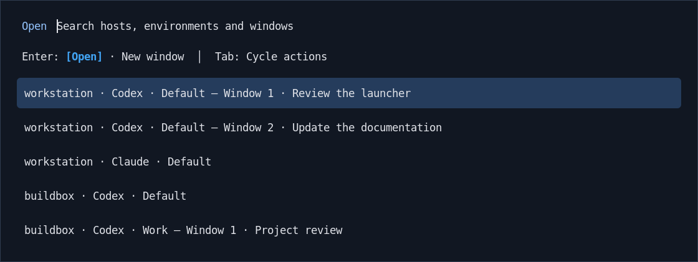

# Rofi Agent Plus

[](https://github.com/byebyebryan/rofi-agent-plus/actions/workflows/ci.yml)

Find your **Codex and Claude environments**, then open or focus their native
TUIs. One searchable picker covers your workstation and remote SSH hosts, with
a separate row for each open window.



*Actual Rofi rendering with sample data and a preview theme. Your Rofi theme
controls its appearance; the sample contains no live sessions.*

Codex Agent Command Center and Claude Agent View handle conversations and agent
work inside those windows. Agent Plus handles discovery, launch and focus.

This is a convenience entrypoint around native shared runtimes. Agent Observer
separately supplies Codex read-only state to dashboards and other utilities;
its retired Claude monitoring does not affect Claude native entry here.

## What it does

- Finds installed Codex and Claude defaults, plus declared additional homes such
  as a separate Codex Work environment.
- Uses [SSH Plus Host Mesh](https://github.com/byebyebryan/rofi-ssh-plus) for
  remote hosts and SSH routes. Each remote TUI runs on the daemon's host.
- Focuses the exact selected window, or creates an independent TUI with
  **New window**. Each client has its own size, view and draft input.
- Opens from a saved catalog immediately. Bounded discovery updates the cache
  in the background while usable rows stay steady.

The supported desktop is **Linux with Niri and dedicated Kitty windows**.
Agent Plus recognizes windows it launched; arbitrary manually launched TUIs
are outside its registry. Mosh, other terminal backends and picker-driven
Close are deferred. The direct-TUI path uses neither Tmux nor Agent Observer.

## Install

You need Python 3.11+, Rofi 2.0+, Niri, Kitty, and a provider CLI supporting
`codex agents` or `claude agents`. The Python package has no runtime Python
dependencies. Remote use also needs OpenSSH, SSH Plus, and the Agent Plus host
helper on each remote host's noninteractive `PATH`.

```sh
git clone https://github.com/byebyebryan/rofi-agent-plus.git
cd rofi-agent-plus
python3 -m venv .venv
. .venv/bin/activate
python -m pip install .
rofi-agent-plus-rofi
```

Run the launcher from your Niri session. Add a binding inside Niri's `binds`
block, using the launcher's absolute installed path:

```kdl
Mod+A { spawn "/absolute/path/to/venv/bin/rofi-agent-plus-rofi"; }
```

Installation does not add a key binding or start provider daemons. The
[managed operations guide](docs/managed-operations.md) describes the repository
owner's separately pinned chezmoi installation.

## Use

| Key | Action |
| --- | --- |
| Up / Down | Select an environment or window |
| Enter | Run the visible action: Open or New window |
| Tab / Shift+Tab | Cycle Open / New window |
| Alt+R | Refresh inventory, joining any pending startup refresh |
| Left / Right, Ctrl+B / Ctrl+F | Move the search cursor |
| Escape / Ctrl+G | Close the picker |

A target with no window gets one launcher row. Once windows exist, each has its
own numbered row and title. **Open** focuses that exact window; **New window**
opens another client for the same environment, without creating a conversation.
Starting or uncertain rows remain selectable for New window; ordinary Open
refuses uncertain focus. Native terminal controls close a window.

Search covers host, provider, environment and title. Titles are sampled once
per open picker, with leading spinner/status icons removed. Reopening samples
them again. Background results never redraw a usable list while you navigate;
reopen or use Alt+R to load updated inventory. An empty list fills automatically
when its first usable results arrive.

## Configure environments

Configuration is optional. Installed providers contribute the owning account's
`~/.codex` and `~/.claude` defaults even when their daemons are stopped. A provider
that is neither installed nor declared contributes no row or missing-provider
warning. Discovery never starts daemons; explicit native TUI entry may start
one according to the provider's configuration.

To label a default or add a prepared home, create
`~/.config/rofi-agent-plus/direct.toml` (or use `XDG_CONFIG_HOME`):

```toml
schema_version = 1

[[environments]]
provider = "codex"
home = "~/.codex"
label = "Default"

[[environments]]
provider = "codex"
home = "~/.codex-work"
label = "Work"
```

Extra Codex homes must already have a readable `config.toml`; extra Claude
configuration directories must already be usable. These rows identify native
homes, rather than Codex `--profile` overlays sharing the same home. Declare
remote homes on their owning host. See the [full example](examples/direct.toml).

## Inspect and develop

```sh
rofi-agent-plus list --json
rofi-agent-plus-host inventory --json
```

Both commands perform bounded passive discovery without opening a native TUI.
The diagnostic separates installation, daemon observations, freshness and local
window presence. An unreachable host retains last-known targets with errors.
Removed peers contribute no cached environment or warning rows; existing
registered windows remain available without granting a new host route.

Read the [architecture](docs/architecture.md),
[development and validation guide](docs/development.md), and
[suite ownership guide](docs/SUITE_INTEGRATION.md). The [documentation index](docs/README.md)
separates current guides from the original design and implementation records.

[MIT license](LICENSE).
