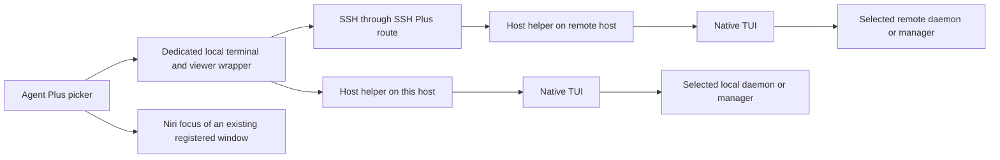

# Agent Plus daemon and TUI design

Date: 2026-10-21

Status: design draft for review. Direct TUIs and individual window rows are the
agreed direction. The defaults and implementation boundaries below complete
that proposal; they do not describe the currently installed Agent Plus.

Agent Plus lists installed agent environments across the local host and SSH
Plus hosts, reports their daemon availability separately, then opens or focuses
their native TUIs. Codex Agent Command Center and Claude Agent View own
conversation browsing and management inside those windows.

Each daemon/profile target can have several independent TUI windows on each
desktop. The ordinary action reuses the selected window. An explicit additional
window action creates another client to the same target. Each client has its
own terminal size, view and draft input, subject to the provider's native client
semantics.

## Product boundary

Agent Plus owns the target picker, direct terminal launch, registration of its
TUI windows and focus on the current desktop. SSH Plus owns logical host
identity, routes and SSH policy. Provider adapters resolve native environments
and enter their native managers. The provider owns its daemon and agent work.

The initial implementation targets Niri and Kitty, matching the existing Tmux
Plus terminal selection inspected during this design pass. Ghostty can use the
same model after its separate window-registration proof. Terminal configuration
for this direct launcher belongs to Agent Plus.

The new path has no Tmux Plus or Agent Observer dependency. It does not acquire
conversation history, observe work phases, create conversations on behalf of
the picker, or keep a rail beside the TUI. The earlier conversation picker,
batch actions and session-client studies retain their historical scope. Normal
terminal controls close windows; a picker Close action is deferred.

Mosh is deferred. Its future transport choice belongs to an individual window
and does not change the target's identity.

## Targets and windows

| Object | Meaning | Identity |
| --- | --- | --- |
| Host | One logical local or remote machine | Host Mesh host ID |
| Target | One provider environment and its native manager scope | Host ID, owning user scope, provider and canonical native home/configuration directory |
| Daemon incarnation | The currently observed native owner, when the provider has one | Provider-specific live endpoint/process generation |
| TUI instance | One registered launch on this desktop | Desktop generation and random instance ID |
| Window | The desktop surface containing that instance | Current compositor window ID, launch marker and process generation |

A target survives daemon restarts. A TUI instance survives picker restarts
while its exact client and window remain alive. Window titles, ordinal numbers,
paths shown in the UI and the current conversation never determine identity.

The target record also carries a human label, launch capability, native
environment selector and a revision of its launch-relevant specification.
Aliases resolving to the same native environment collapse to one target.
Distinct native environments remain separate even when their labels match.
A changed environment selector invalidates the old launch specification.
For a home-scoped daemon, its current socket path and PID belong to the daemon
incarnation, not the target key. An explicit endpoint declaration would need a
stable configured selector of its own; arbitrary endpoint discovery is outside
the initial default-plus-declared-home guarantee.

For Bryan's Codex environments, OSS and Work refer to separate native homes and
endpoints. A model setting or a native configuration overlay sharing the same
daemon does not create another daemon row. The current Work wrapper ultimately
executes the same Codex executable as the default launcher; executable name is
insufficient to identify the environment.

Claude's native manager is `claude agents`. Its supervisor is scoped to the
Claude configuration directory; `CLAUDE_CONFIG_DIR` selects a separate instance
with its own sessions. A Claude target therefore represents that configuration
scope and supervisor, while per-conversation workers remain inside it. The
installed adapter must verify Agent View availability and select that exact
environment.

## Target discovery

Discovery runs on the host owning the provider environment. Agent Plus ships a
small host helper with provider-specific adapters; the desktop invokes the same
helper locally or through Host Mesh SSH routes. Remote hosts need that helper
installed even when they have no graphical desktop. The headless helper imports
no Rofi, terminal, Observer or Tmux components.

The first host helper enumerates installed default environments and optional
host-local declarations of additional homes. A declaration supplies a provider,
display label and native home/configuration selector; an optional declaration
ID is an alias rather than a second identity for that native environment.
Provider adapters construct native commands from these fields. Remote inventory
does not supply arbitrary commands for the desktop to execute.

Discovery proceeds in this order:

1. Resolve the provider executable in the owning user's launch environment and
   check its version and required native command capabilities with bounded
   noninteractive probes. Installation, authentication readiness and daemon
   availability are separate facts. An installed CLI may need native setup on
   explicit entry.
2. Enumerate the default native environment plus declared additional homes or
   configuration directories. Retain these targets even before any daemon has
   started. The configuration owner can render declarations from the same
   environment metadata that installs launchers such as `codex-work`.
3. Deduplicate native environments and validate their launch selectors. For
   Codex, OSS/Work homes selected by `CODEX_HOME` are separate targets. Native
   `--profile` files such as `$CODEX_HOME/chatgpt.config.toml` are configuration
   overlays within that home; their presence does not establish another daemon
   and does not add target rows.
4. Probe the existing daemon for each target without starting it. Record
   running, positively stopped or unknown independently of installation and
   launch capability. Native evidence describes those covered environments;
   automatic discovery of arbitrary undeclared live homes is deferred.
5. Combine the environment catalog with this desktop's registered windows to
   produce launcher rows or individual TUI rows.

Default provider environments are included when installed. Additional custom
homes require a declaration on their owning host in the first implementation,
even if a daemon is already running there. Shell aliases and guessed
home-directory names are insufficient. Discovery covers the configured login
user and supported provider topologies; it is not a privileged census of every
user's processes.
The initial guarantee is installed default environments and declared additional
homes. Extra declarations must resolve to prepared native environments; a typo
or missing Work home is an unavailable target, not permission to create a fresh
profile. An absent default home may use ordinary native first-use setup on
explicit Open. Discovery creates neither kind of home.

Every discovered live daemon appears even with zero conversations. Known
environments with no running daemon remain launchable target rows when the
adapter supports native startup. Discovery itself never starts a daemon, opens
a TUI or authenticates interactively. Partial discovery carries a visible
provider/host coverage result, preserving healthy siblings.

The inventory separates these facts:

| Fact | Values and meaning |
| --- | --- |
| Native availability | Running, stopped with current evidence, or unknown |
| Launch capability | Supported, unavailable, or unsupported with a reason |
| Observation freshness | Current or last known |
| Local window presence | Registered instances on this desktop, observed separately |

An unreachable host is unknown, not stopped. A terminal window does not prove
that its daemon is reachable or that a remote TUI has connected successfully.
Provider versions are diagnostics; adapter support follows required native
contracts and capabilities rather than a frontend version allowlist.

For Claude, `claude daemon status` is the documented supervisor-status command
and the candidate passive probe to qualify on the installed provider.
`claude agents --json` lists sessions and does not define the daemon catalog.
For Codex, use `codex app-server daemon version` in the selected `CODEX_HOME`
as the native status candidate; the inspected version emits JSON for a reachable
daemon but exits nonzero without JSON when its control socket is absent. Neither
probe substitutes for enumerating environments. Do not map every nonzero exit
to stopped: configuration, permission and transport failures remain unknown.
Confirmed stopped requires current host-local absence evidence for that target;
an unreachable daemon can still have a useful launcher row. Isolated empty-home
checks on the inspected versions started no daemon, including with Codex
auto-start enabled. Preserve that property in implementation checks.

Use one optional `~/.config/rofi-agent-plus/direct.toml` file on each host. Its
host-side section declares additional environments or labels the detected
default; its desktop section selects the terminal backend and refresh behavior.
Hosts, aliases and route policy remain in SSH Plus. Private credentials and
company connection settings remain provider-owned. Configuration schema 1 and
the host-helper wire are new contracts. The new artifact reads this file
exclusively; the earlier `config.toml` remains an independent rollback input.

Target catalogs and UI preferences use new `direct-v1` cache/state directories.
Window registrations use a `direct-v1` runtime directory scoped by desktop
generation. The old session cache, preferences and managed artifacts do not
become inputs to this path.

## Daemon startup

Agent Plus discovers environments whether their daemons start at boot, on demand
or through an explicit native command. Startup policy is a native configuration
fact, not a requirement for a target to appear.

| Provider | Native startup behavior relevant to this design |
| --- | --- |
| Codex | The inspected Snap/Starship homes enable `features.daemon_auto_start`, allowing native TUI entry to start the shared daemon on demand. Boot startup requires separately selected service/startup integration; the feature flag alone does not establish it. |
| Claude | Opening `claude agents` or starting background work starts the supervisor on demand. Snap's installed 2.1.306 daemon help explicitly disables service installation and describes an on-demand lifetime. Current status identifies a transient supervisor retained by native clients and background workers. |

An explicit Open may therefore start the target's daemon through the native
manager. Opening or refreshing the picker does not. A native manager unavailable
under the current configuration is an explicit setup/capability condition;
Agent Plus does not silently change feature flags or install boot services.
Existing boot services are left under their current owner's policy.

The first picker after a reboot must still contain installed default and
declared extra environments when every daemon is stopped. A stopped daemon
does not remove the launcher row. The [discovery review](agent-plus-daemon-tui-design-review.md)
records the current two-host check separately from this required behavior.

## Picker rows and actions

The initial picker is one searchable list across all configured hosts. Targets
follow Host Mesh host order, then stable provider/environment order. Instances
of the same target remain adjacent in ordinal order. Title and focus changes
do not reorder rows.

A target with no registered TUI contributes one launcher row. A target with
registered TUIs contributes one row per instance, including an instance whose
terminal is still opening. No additional daemon header row is needed.

```text
Snap       Codex · OSS     1 · Agent Plus design
Snap       Codex · OSS     2 · Rendering investigation
Snap       Codex · Work    1 · Window 1
Starship   Claude             Open TUI…
```

The actual Rofi presentation can retain provider icons and two-line rows:
provider/environment, instance number and window title on the primary line;
host, local/SSH transport and necessary availability notices on the second.
Host and environment labels stay searchable regardless of title changes.
Unavailable hosts with no known targets contribute an explanatory status row.
Status rows do not act as launch targets.

Numbers are assigned per target on this desktop and stay stable for an
instance's lifetime. Closed numbers may be reused for later launches; the
random instance ID remains the selection key. The dynamic terminal title is
used when meaningful, otherwise the label is `Window N`. Control characters
and markup are escaped. A title is presentation text, not a claimed current
conversation binding.

| Selected row | Open | Open another window |
| --- | --- | --- |
| Existing TUI instance | Revalidate and focus that exact window | Launch another TUI for the same target |
| Opening instance | Focus its window if available; otherwise show opening status | Launch another instance for the same target |
| Target with no instance | Launch its first TUI | Launch a TUI with the same result |
| Known target on an unavailable host | Existing windows remain focusable; a new launch requires fresh route/target validation | Same fresh validation |
| Target whose launch contract is unsupported | Existing windows remain focusable; show the reason for a refused launch | Show the reason |

Open another window creates a native client, not a new agent conversation.
The user chooses conversations in the native manager. Each desktop's list
contains only its own windows, including windows connected to remote targets.
Two desktops opening the same target receive separate native TUIs.

| Key | Behavior |
| --- | --- |
| Up / Down | Select a row |
| Enter | Run the visible action on that row |
| Tab / Shift+Tab | Cycle Open and Open another window |
| Alt+R | Request a bounded inventory and window refresh |
| Left / Right, Ctrl+B / Ctrl+F | Edit the search text through Rofi's native bindings |
| Escape / Ctrl+G | Close the picker |

Every dialog starts with empty search and Open selected. It restores the last
successfully used exact row when still present, otherwise a row for that target,
otherwise the first selectable row. During refresh, preserve the selected
instance/target key and filter. If that key disappears, choose the nearest
surviving matching row without running an action. Title updates may change
filter membership, but never retarget a pending action.

## Direct launch and focus



Launch creates a dedicated terminal OS window and one foreground viewer wrapper.
The wrapper owns registration and the direct TUI or SSH client, and ends when
that client exits. It never supervises, restarts or terminates the agent daemon.
The terminal starts independently of picker lifetime with a real attached TTY.
Closing the picker leaves accepted launches and existing windows alone.

Before native entry, resolve the same owning target and verify its current
launch specification and capabilities. A bounded preflight refresh supplies
current facts when available. If noninteractive SSH authentication prevents that
refresh, explicit Open may authenticate in its terminal and let the host helper
perform validation there before starting the native client. A cached target
reference never authorizes execution of a stale command. A changed selector,
missing target or unsupported contract produces a specific failure, never a
fallback to another profile. Entry attaches to the current native daemon for
that same environment, including a daemon that restarted after discovery.
Daemon incarnation is diagnostic here; it is not a launch precondition. Unknown
daemon status alone does not block a valid environment's native startup. An
explicit Open may use the provider's supported native startup path; browsing
may not.

Native entry uses `codex agents` for Codex and `claude agents` for Claude in the
selected environment. Codex's installed CLI help describes its entry as browsing
the shared local app-server daemon; Claude documents its entry as Agent View.
The exact executable, native home/configuration directory, inherited endpoint
overrides and working directory must be resolved for that target on its owning
host. The host helper uses the owning user's home as its working directory,
independently of the picker's repository; it must preserve required provider
settings and ordinary hooks. Opening the manager must not implicitly create a
conversation. Explicit Claude manager entry may start its supervisor when absent, through Claude's
normal behavior.

Focus uses the current desktop's live compositor window and registered launch
identity. It does not need a remote probe: a known remote window remains useful
for reading its screen, reconnecting natively or seeing an SSH failure. If the
selected window has disappeared, refresh the rows and report that result.
That instance action does not silently turn into a new launch.

First launches are serialized per target and desktop. Under the lock, Open
rechecks local instances: reuse a sole existing one, or redisplay individual
rows if several appeared since the launcher row was rendered. It does not
create a duplicate simply because the initial window is slow to map. Explicit
additional launches receive distinct instance IDs; retrying one request uses
its original request/instance ID.
One submitted picker action has one request ID across callbacks. A second
deliberate additional-window action receives a fresh ID. IDs are never derived
from row titles or ordinal numbers.

Failure to read the compositor or validate the registry is unknown window
presence, not an empty target. Preserve the relevant rows with that diagnostic
and refuse the affected actions until their desktop/target evidence is valid.
A broken record affects its own target rather than invalidating healthy
siblings; loss of the compositor affects the whole desktop.
Retire an uncertain opening reservation only when its exact launcher, client
and window are confirmed absent; elapsed time alone is insufficient.

## Window registration and manual launches

Agent Plus launches carry a unique application ID or equivalent marker and an
opaque instance ID. Dedicated Kitty launches use one OS window per process and
allow native dynamic titles. Niri supplies the actual window ID and process
identity. Global Kitty remote control is not required for this launch path.
The Kitty adapter must prevent tabs, splits or extra OS windows from making a
registered association ambiguous; changed layouts become unsupported for reuse
until the association can be proved again.

The local runtime registry records the target key/specification, desktop
generation, instance ID/ordinal, launch state, terminal/window handle and exact
foreground wrapper/client process generation. It also records local or SSH
transport and the selected remote route for that instance. Endpoint paths and
other private launch material stay in the owning host's protected local state.
Persist only the bounded local reference needed to request and validate entry.

Use a private runtime directory, atomic records and a short lock for registration.
Validate records against the current compositor generation, launch marker and
process birth identity on read and immediately before focus. Window IDs and
PIDs alone are insufficient. The registry survives picker restarts within the
same desktop session; a new desktop generation cannot adopt old handles.

Registration follows the foreground client, not any daemon or worker descendant
that inherited its environment. The wrapper unregisters on normal exit; later
reads reconcile abrupt exits and stale files. TUI/SSH exit retires the instance
even if a terminal remains open at a shell or error prompt. No cleanup routine
kills provider descendants. Once the last instance is gone, the target's
launcher row reappears if the target is still known.

| Launch origin | Initial reuse guarantee |
| --- | --- |
| Agent Plus | Registered, live instances are reusable |
| User invokes a future registration-aware local wrapper | Same guarantee after that optional integration is implemented |
| Plain local TUI | Automatic adoption deferred until terminal, foreground client and exact target can be proved |
| User enters an arbitrary SSH shell and starts a TUI | Automatic adoption unsupported without additional integration |
| Several tabs or splits inside a manually opened terminal | Automatic adoption unsupported initially |

Manual launches need not go through the Rofi picker to become reusable if they
later opt into registration. The initial implementation only guarantees Agent
Plus launches. An unregistered manual TUI may coexist with a newly opened
Agent Plus window. This limitation must appear in user documentation.

## Remote entry and unreliable connections

Read Host Mesh through SSH Plus's public CLI. Use logical host IDs as target
identity and retain the chosen route only as transport context. Validate an
authenticated host-helper response against the requested logical host and
login-user scope; a route's display name alone does not establish host identity.
The remote helper resolves its own local Host Mesh identity rather than echoing
the caller's requested host ID.

Use the existing bounded route selection and SSH policy for inventory. Discovery
never updates successful-connection history or opens an authentication prompt.

For an explicit launch, select an eligible route from the current Host Mesh
catalog before dispatching the interactive host-entry command. Authentication
and final host/target validation can complete inside that terminal. SSH owns
host-key, authentication and terminal behavior. Remote command arguments must
be encoded for SSH's remote shell boundary using a fixed entry command and
validated bounded references. Titles
and other presentation data never become shell commands.

Once interactive entry is dispatched, do not retry it on another route after
an uncertain failure. A local terminal spawn establishes window creation only;
it does not prove SSH authentication, remote TUI entry or daemon connection.
Those prompts and failures remain visible in the native terminal, with bounded
launch diagnostics available in the picker. An opening record is reconciled
against its exact launcher, wrapper and window. A timeout with uncertain process
state is shown as uncertain and does not authorize another first launch.

After an established SSH client exits, its instance retires. A later explicit
Open creates a fresh TUI for the same target. If SSH is stalled but its client
and window remain alive, Open focuses that window; it does not infer an agent
failure or create a replacement. Native daemon/work survival after client loss
must be qualified per provider. Screen position, native view and unsent input
are allowed to be lost when the TUI exits.

A future Mosh action can create another instance for the same target and label
its transport. Adding Mosh requires separate route, authentication, terminal
compatibility and reconnect acceptance. Existing SSH instances keep their
transport. The initial design adds neither automatic reconnection nor a
background transport supervisor.

## Refresh and retained state

Opening the picker reconciles local registered windows immediately and reads
cached host catalogs. It starts a finite bounded refresh for stale/missing
catalogs while keeping available rows selectable. Healthy hosts publish without
waiting for a failed peer. Repeated row navigation and action cycling read the
current frame and do not run provider or SSH collection.

While the picker is open, reuse the existing Rofi script-mode timeout callback
to refresh the small local window/registry view, initially at one second. Each
callback performs a bounded Niri window read and checks registered process
handles; it does not run native provider or SSH probes. It reloads updated rows
while preserving the filter, action and selected identity. An event stream alone
cannot redraw a script-mode dialog, and a new native Rofi plugin is unnecessary
for this first implementation. Validate timer behavior while typing in the
actual installed Rofi.

If the existing timeout mechanism cannot preserve search/caret behavior, the
first candidate may use whole-view snapshots on opening and Alt+R instead.
That strategy takes a finite bounded inventory snapshot before rendering and
retains partial/last-known rows; catalog and title changes appear on the next
explicit refresh/callback. Document the freshness and cold-opening latency
limits. Choose one tested strategy rather than adding a configurable mode.
Current window existence and identity are still validated before every focus.
A native plugin or persistent watcher is outside this implementation.
Inventory/SSH work never moves onto a periodic title-refresh path.

The lightweight wrapper records lifecycle transitions. Host catalog refresh is
demand-driven by startup expiry, explicit Alt+R and new launch validation.
Closing the picker stops its finite catalog helpers and timer, not its windows.
No always-on Agent Plus discovery service is needed.

Keep last-known target rows during a host/provider outage, with the original
observation age and unavailable reason. New launches require fresh target
validation. Previously registered windows remain focusable using local evidence.
A complete current inventory may remove a vanished target; live registered
instances for it remain visible as unavailable-target windows until they exit.
Their additional-window action is refused until the target is valid again.

Persist target catalogs and UI preference state separately from the runtime
window registry. Do not reuse old conversation caches or native-session
preferences as target or window identities. Dynamic titles are bounded
presentation data kept in memory while displaying the picker; do not copy
terminal contents, drafts, transcripts or credentials into the catalog.

## Implementation sequence and acceptance

| Step | Required result |
| --- | --- |
| Native contracts | Establish passive enumeration, exact environment selection, zero-conversation targets and manager entry for Codex OSS/Work and Claude on their owning hosts |
| Direct window proof | Dedicated Niri/Kitty window registration and exact focus survive dynamic titles, duplicate requests, TUI exit and picker restart |
| Multiple clients | Two TUIs to one target can select different conversations, keep independent sizes and drafts, and close independently under native provider semantics |
| Host helper and transport | Versioned bounded catalog/entry contract, correct Host Mesh identity and SSH route selection, visible partial failure and no replay after uncertain dispatch |
| Picker implementation | Flat individual-window rows, launcher-row transitions, two actions, stable selection and current local window evidence |
| Native acceptance | Real local/remote TUIs, profile separation, simultaneous desktop use, authentication/error paths, resize, paste, modified keys, scrolling and controlled SSH loss |
| Delivery | Separate packaged, installed and managed desktop checks with a retained rollback; restore a desktop binding only as part of an explicitly authorized rollout |

The native proof must check more than two clients existing: switching views in
one must leave the other usable, and closing one must not stop the other client
or accidentally terminate provider-owned work. Same-conversation concurrency
follows the native manager's behavior; the required first case is two different
conversations on one target. Any unsupported provider behavior reopens that
adapter's design without weakening the sibling provider's identity guarantees.

Meaningful implementation checks cover target deduplication, partial catalogs,
installed environments with all daemons stopped, native profile overlays that
share a home, stopped/unknown distinctions, process/window generation reuse,
registration cleanup, stale selection, profile changes between selection and entry, first
launch races and repeated callback delivery. An explicit additional-window
request creates one instance, while two distinct requests may create two.
Remote timeout or native-start uncertainty never triggers an automatic replay.

Implementation can replace the retired session picker once the host/desktop
proofs pass. Reuse the Rofi launcher, icons, escaping and validated public Host
Mesh integration where suitable. Retire session history, Observer writer, tmux
attachment and batch/viewer scaffolding from the new path rather than retaining
them as hidden dependencies. Preserve old installed artifacts and external
rollback selectors during development. This draft changes no runtime, managed
configuration, desktop binding or provider service.

## Review questions

Product defaults proposed here are Niri/Kitty first, one all-host list, Open and
Open another window as the two actions, normal terminal controls for closure,
and configured stopped environments remaining available for explicit launch.
These complete the agreed direct-TUI and individual-row model for review.

Native proof still needs to verify installed environment selection and passive
discovery, including custom environments, plus each provider's multi-client and
client-exit behavior. The focused [design review](agent-plus-daemon-tui-design-review.md)
tracks these dependencies separately from the product decisions.

The [implementation plan](agent-plus-daemon-tui-implementation-plan.md) maps
the revised design into native proofs, host discovery/entry, window lifecycle,
SSH integration, the picker and separate delivery steps. It also defines the
unattended candidate boundary, test/recovery behavior and a goal instruction;
human input acceptance and managed rollout remain explicit separate gates.

## Source references

- [Current Agent Plus runtime](../README.md) and [suite ownership](SUITE_INTEGRATION.md)
  describe the earlier conversation picker and its unsupported client binding.
- [Host Mesh v1](../contracts/host-mesh-v1/contract.md) defines logical hosts,
  route order, SSH policy and typed failure behavior.
- Installed `/usr/bin/codex --help`, `codex agents --help` and
  `codex app-server daemon --help` were inspected on 2026-10-21. They establish
  available CLI entry points, not multi-client or passive-discovery acceptance.
- [OpenAI configuration guidance](https://learn.chatgpt.com/docs/config-file/config-advanced#profiles)
  defines native profile overlays and `CODEX_HOME` state locations.
- [Claude Agent View](https://code.claude.com/docs/en/agent-view) documents
  `claude agents`, supervisor startup, `CLAUDE_CONFIG_DIR` instance separation
  and `claude daemon status`. The command and configuration scope are established;
  installed routing and concurrent-window integration still need acceptance.
- [Kitty invocation](https://sw.kovidgoyal.net/kitty/invocation/) documents
  application IDs and the fixed-title behavior to avoid for dynamic labels.
  [Kitty remote control](https://sw.kovidgoyal.net/kitty/remote-control/)
  describes optional window/process inspection useful for later manual adoption.
- [Niri window API](https://niri-wm.github.io/niri/niri_ipc/struct.Window.html)
  documents window IDs, titles, application IDs and the Wayland-connection PID.
  [Niri IPC](https://github.com/niri-wm/niri/wiki/IPC) supplies window events;
  [FocusWindow](https://niri-wm.github.io/niri/niri_ipc/enum.Action.html#variant.FocusWindow)
  supplies focus by current window ID.
- [Ghostty class configuration](https://ghostty.org/docs/config/reference#class)
  supports a future direct-window adapter, with GTK instance behavior to validate.
