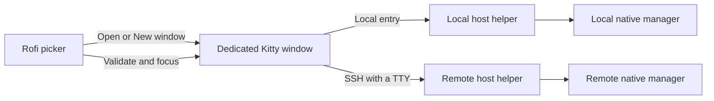

# Architecture

Agent Plus selects **native environments and local TUI windows**. Codex Agent
Command Center and Claude Agent View select and manage conversations inside
those windows.

## Direct clients

The TUI and its daemon live on the same host. Remote windows contain an SSH
client connected to that host. Two desktops get independent TUI clients;
there is no shared Tmux session or shared terminal size. Native provider
semantics determine which view and draft state each client retains.

The first desktop adapter supports Niri and a dedicated Kitty process with one
OS window, tab and pane. A private control socket enables per-instance layout
validation without enabling global Kitty remote control. Changing that layout
can make focus validation refuse the window.

## Identity

| Object | Identity and lifetime |
| --- | --- |
| Host | Logical Host Mesh ID |
| Environment target | Host ID, effective UID/account, provider and canonical native home |
| Launch specification | Digest of adapter, executable path and environment selection |
| TUI instance | Random instance ID within one desktop generation |
| Window | Exact compositor window, launch marker and terminal process generation |

Targets survive daemon restarts. A changed daemon PID, model setting, label or
window title does not change the target or its launch specification. Separate
Codex homes selected by `CODEX_HOME` are separate targets; `--profile` overlays
within one home do not add targets.

Each dedicated window has an `org.agentplus.<instance-id>` application ID.
Titles and reusable Window 1/2/3 ordinals are presentation, never action
authority. Manually launched TUIs lack the owned registration and are not
adopted by scanning titles or command lines.

## Passive discovery

The headless helper discovers the owning account's `~/.codex` and `~/.claude`
defaults when their CLIs are installed. Inherited `CODEX_HOME` and
`CLAUDE_CONFIG_DIR` cannot hide defaults or add undeclared homes. Optional
host-local declarations label defaults or add prepared environments.

Additional Codex homes require an existing readable `config.toml`. Additional
Claude directories must exist and be usable. A missing default can remain
available for native first-use setup on explicit entry. Discovery creates no
homes, starts no daemons, authenticates no accounts and lists no conversations.

Capability probes check native manager support. Daemon status is a separate
passive observation using `codex app-server daemon version` or
`claude daemon status`. Recognized evidence yields running or stopped;
unexpected output, timeouts and transport failures remain unknown. Daemon
startup and boot policy belong to the provider.

An uninstalled, undeclared provider is normal absence. Explicit declarations
for a missing provider retain a diagnostic. Partial discovery preserves healthy
siblings and last-known targets with their original observation times; a
complete current inventory can withdraw a missing target. Unknown is never
treated as an empty or stopped host.

## Host transport and native entry

SSH Plus owns host identity, route order and SSH policy through
[Host Mesh v1](../contracts/host-mesh-v1/contract.md). When its CLI is absent,
the helper can operate with a local-only identity. A configured Mesh failure is
an error, rather than permission to invent a replacement host identity.

Passive remote inventory uses BatchMode, strict host-key checking, bounded
output and an authenticated reached-host marker. It can try another eligible
route only when the observation permits that fallback. Interactive entry pins
one route from a fresh Mesh view, allocates a TTY and allows native SSH
authentication. An uncertain entry is never replayed through another route.

Entry carries a bounded reference to the expected host, user, target and
specification revision. The owning helper resolves them again before exec. It
changes to the owning account's home and runs the installed `codex agents` or
`claude agents`. Codex sets `CODEX_HOME` and clears `CODEX_PLUS_SOCKET`; Claude
sets `CLAUDE_CONFIG_DIR`. Inventory cannot supply executable commands.

Native entry or SSH errors remain readable in the owned terminal until
dismissal. The wrapper records its foreground client's lifetime; it does not
supervise or terminate provider daemon/worker descendants.

## Window actions and recovery

An environment without an instance has one launcher row. Otherwise every
registered instance has a row, including starting, opening and uncertain
instances. Host/provider diagnostics are nonselectable.

Open on an instance revalidates and focuses that exact window without a
provider or SSH probe. A missing instance produces a stale-selection notice;
a nonlive instance refuses focus. Neither case silently launches a replacement.
New window explicitly requests an additional client for the row's target.
Unavailable targets still refuse entry.

The registry persists dispatch intent before spawning. First opens serialize
per target; repeated callbacks with one request ID resolve the same instance.
A deliberate New window gets a new request ID. A launch gap with insufficient
evidence stays uncertain; it is not retired merely because time passed. The
user can select that row and explicitly request another window without
replaying or discarding the original uncertain request.

Before focus, Agent Plus checks desktop generation, process-birth handles,
the window marker and the private Kitty foreground layout. Compositor failure
or ambiguous layout refuses focus. Registered local windows can remain
focusable even when their remote host is unreachable or removed from Mesh.

## Refresh and responsiveness

The first frame uses the saved catalog and current local window observations.
Missing or stale inventory reserves one passive worker per private catalog.
A file lock transfers to that worker and stays held after the picker closes.
Reopening joins its finite work, including
when early publication has already made the available cache look fresh.
The lock releases on completion, crash or deadline so a later open can retry.

Each host result publishes atomically as it arrives. An empty list checks at
most twice per second until its first selectable rows, completion or timeout.
Once rows are usable, automatic redraw callbacks stop and any armed timeout
action is disabled. This avoids Rofi's idle callbacks consuming navigation.

Reopen or Alt+R loads updated inventory; explicit action callbacks may also
observe the latest cache. Alt+R joins pending work or performs a new bounded
refresh. Published failures appear on the next callback/reopen, rather than
redrawing an idle usable list. Titles and their search text are sampled once
per dialog, with leading native status icons stripped. Presence and action
validation still use current process/window identity.

## Private state and bounds

| State | Location |
| --- | --- |
| Catalog and finite startup ticket/lock | `$XDG_CACHE_HOME/rofi-agent-plus/direct-v1/` |
| Last successful target/instance hint | `$XDG_STATE_HOME/rofi-agent-plus/direct-v1/view.json` |
| Desktop registrations and replay tombstones | `$XDG_RUNTIME_DIR/rofi-agent-plus/direct-v1/<desktop-generation>/` |
| Per-instance Kitty socket | `$XDG_RUNTIME_DIR/rofi-agent-plus-sockets/<instance-id>.sock` |

Configuration is optional schema 1 `direct.toml`; the retired `config.toml`
and conversation caches are not inputs. Files and directories are private,
versioned and validated. The catalog is display/performance state, never launch
authority. Tombstones preserve replay identity after an instance exits.

| Work or record | Bound |
| --- | --- |
| Provider capability/status probe | 3 seconds; capability cache TTL 300 seconds |
| One host / whole fleet | 12 / 20 seconds; at most 4 host workers |
| Detached startup worker | 30-second overall deadline; no persistent service |
| New Alt+R refresh / pending-worker join | Fleet bound / worker's remaining deadline |
| Compositor request | 1 second |
| Host inventory / entry reference | 1 MiB / 64 KiB |
| Host targets / diagnostics | 128 / 256 |
| Catalog / host records | 8 MiB / 256 |
| Config / environment declarations | 256 KiB / 128 |
| Active instances | 512 per target; retired request tombstones are separate |
| Rofi callback state / first frame | 16 KiB / 16 MiB |

Inventory deadlines do not terminate interactive provider TUIs or SSH login
prompts. [Validation](development.md) and [managed selection](managed-operations.md)
have separate acceptance scopes.
